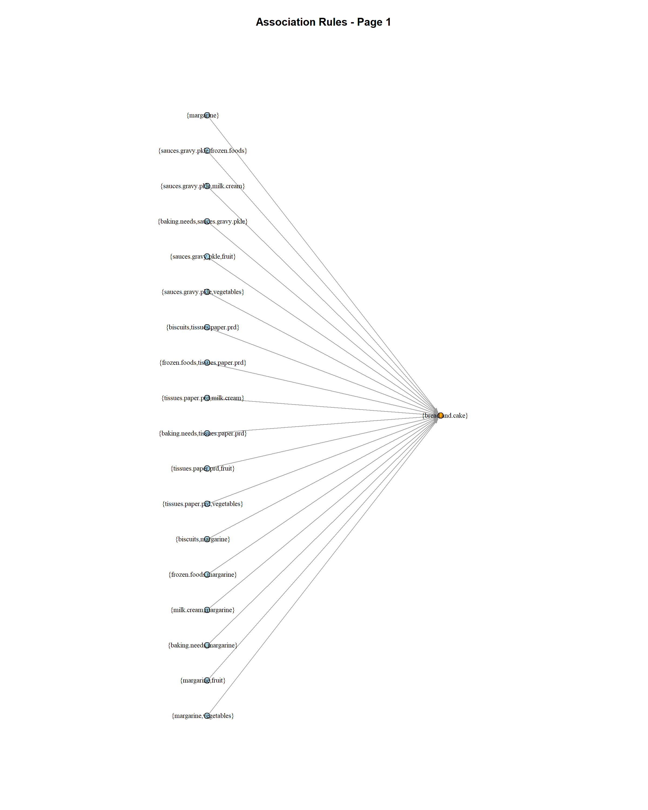
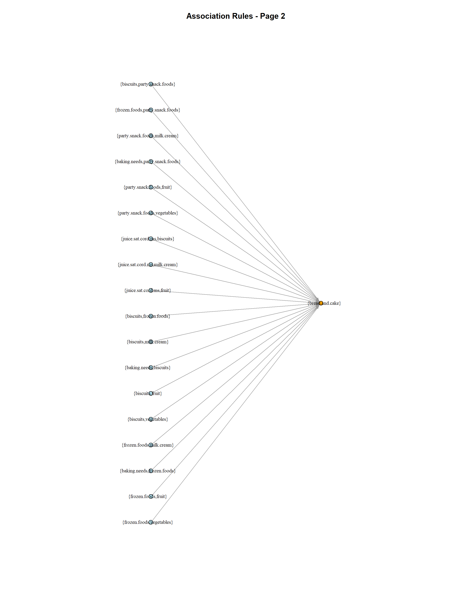
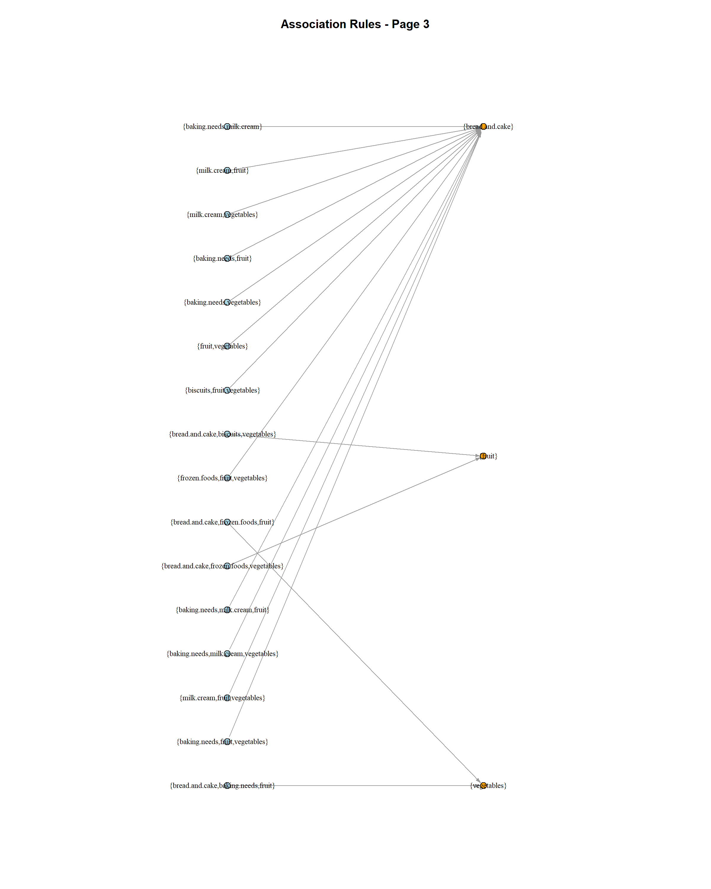

# Supermarket Association Rule Mining

Association rule mining in R to explore supermarket purchasing patterns using the Apriori algorithm. The analysis compares frequent and maximal frequent itemsets, ranks rules by confidence and lift, checks redundancy, and visualizes the resulting rules.

**Author:** Fatema Khatun

## Dataset

`Supermarket (1).csv` contains **4,627 transactions and 216 item columns**. Each row represents a transaction. A `t` indicates a purchased item; `?` indicates an item not purchased. The script converts these entries into a logical matrix and then an `arules` transactions object. Only purchased items are mined.

The dataset was supplied with the course project materials. Original dataset provenance and redistribution terms are not documented in this repository.

## Repository Files

| File | Description |
| --- | --- |
| `Project2_Milestone1_Fatema.R` | Complete analysis script |
| `Supermarket (1).csv` | Transaction dataset |
| `Requirement3_Graph_Page1.png` | First 18 verified rules |
| `Requirement3_Graph_Page2.png` | Next 18 verified rules |
| `Requirement3_Graph_Page3.png` | Remaining 16 verified rules |
| `README.md` | Project overview and instructions |

## How to Run

1. Install R and open RStudio.
2. Download this repository using **Code → Download ZIP**, then extract it, or clone it with Git.
3. In RStudio, open `Project2_Milestone1_Fatema.R`.
4. Select **Session → Set Working Directory → To Source File Location** so the script can find the dataset.
5. Run the script from beginning to end. Select all code and press **Ctrl + Enter** on Windows, or **Cmd + Return** on macOS.

The script installs missing packages: `arules`, `arulesViz`, and `igraph`. An internet connection is required for installation. `arulesViz` is loaded by the script; the graph construction and plotting use `igraph`.

Keep the CSV filename unchanged. Results appear in the Console, an overview graph appears in the plotting window, and three graph images are saved in the working directory. Running the script again replaces the three generated PNG files.

## Analysis Settings

- Minimum support: **0.25** for itemsets and rules.
- Minimum confidence: **0.80** for rules.
- Minimum itemset length: **1** for itemset mining.
- Minimum rule length: **2**, ensuring nonempty antecedents.
- Top rules: **20** per ranking, selected separately by confidence and lift from the same generated rulebase.
- Redundancy: checked with `is.redundant()` using its default confidence criterion.

## Key Results

| Measure | Result |
| --- | ---: |
| Frequent itemsets | 224 |
| Maximal frequent itemsets | 130 |
| Compression ratio by itemset count | 1.7231:1 |
| Reduction in itemset count | 41.96% |
| Generated rules | 52 |
| Redundant rules within the generated rulebase | 0 |
| Distinct consequents in the top 20 by confidence | 1 |
| Distinct consequents in the top 20 by lift | 3 |

The compression ratio is `224 / 130`. The reduction is `(224 - 130) / 224 × 100`. These measure itemset counts, not memory usage in bytes.

All 20 confidence-ranked rules predict bread and cake. The lift-ranked selection predicts bread and cake 16 times, fruit twice, and vegetables twice. Lift therefore improves consequent diversity in this selection.

The highest-lift rule is:

**{bread and cake, biscuits, vegetables} → {fruit}**

- Support: approximately **0.2628**.
- Confidence: approximately **0.8177**.
- Lift: approximately **1.2774**.

Fruit is about 27.74% more likely in transactions containing this antecedent than in transactions overall. This is an association, not evidence of causation.

## Rule Graphs

Each node represents a complete itemset, and each arrow represents a rule from its antecedent to its consequent. Blue nodes are antecedents and orange nodes are consequents in these graphs. The 52 retained rules are split across three images for readability.

Across the full rulebase, 48 rules predict bread and cake, two predict fruit, and two predict vegetables. Splitting the visualization into pages is for presentation and does not represent a clustering result.

### Rules 1–18

### Rules 19–36

### Rules 37–52

## Frequent Items Missing from the Top Consequents

The script identifies the three most frequent singleton itemsets absent from the consequents of the top 20 lift-ranked rules:

| Itemset | Transaction count | Support |
| --- | ---: | ---: |
| Milk and cream | 2,939 | 63.52% |
| Baking needs | 2,795 | 60.41% |
| Frozen foods | 2,717 | 58.72% |

These are evidence-based candidates for further exploration as target consequents. The script identifies the candidates; it does not generate an additional targeted rulebase.

## Scope

This project covers association rule mining. Clustering is outside its scope. The class report is maintained separately from this repository.
